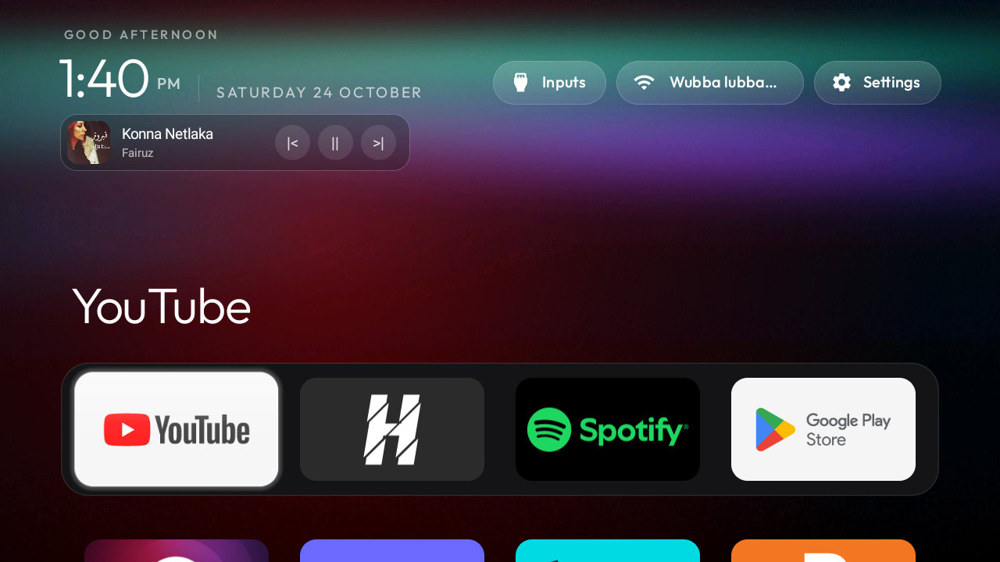
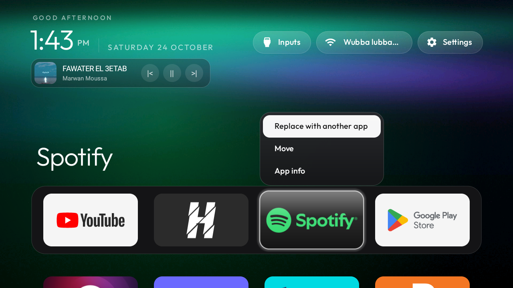

# CleanYourTV - Custom Edition (Now Playing Widget & Smart Wi-Fi Popup)

An enhanced, custom-built edition of **CleanYourTV** for Android TV / Google TV. Designed with an Apple TV frosted-glass aesthetic, featuring an interactive **Now Playing Media Widget**, an in-launcher **Smart Wi-Fi Scanner & Auto-Connector**, and a **One-Click Portable Auto-Installer**.

---

## 📸 Screenshots

### 1. Home Screen & Frosted Now Playing Widget (Under the Clock)


### 2. Smart Frosted Wi-Fi Popup (3-Network Scrollable List & Auto-Connect)


### 3. Long-Press Tile Menu (Move & Reorder Apps)


---

## ✨ What's New in This Custom Edition

| Custom Feature | Technical & Visual Details |
| :--- | :--- |
| **🎵 Frosted Now Playing Widget** | Positioned cleanly in the space right under the clock (`NowPlayingCard.java` + `MediaNoteService.java`). Displays live **Album Art**, **Track Title**, **Artist Name**, and D-Pad focusable **`Prev` / `Play-Pause` / `Next` transport buttons** that scale and glow on focus. Works seamlessly with **Spotify**, YouTube, and any active Android `MediaSession`. Automatically hides when playback stops. |
| **📶 Smart Frosted Wi-Fi Popup** | Replaces the stock Android Wi-Fi settings jump with an in-launcher frosted glass popup (`R.layout.popup_inputs`). Shows the **Currently Connected SSID** with a green status dot, followed by a **compact 3-row scrollable list (`ScrollView`)** of available nearby Wi-Fi networks sorted by signal strength (`[++++]`), **instant auto-connect** for saved/open networks, and an in-launcher **glass password input dialog** for new networks. |
| **🎨 Clean 4-App Aurora Setup** | Pre-configured with the **Aurora** theme, 4-app rounded dock, long-press `OK` tile reordering (`tile_menu: true`), Clock screensaver (`ClockDreamService`), and `0.5x` snappy system animations—without RAM/CPU stat clutter or extra buttons. |
| **⚡ One-Click Auto Installer** | Includes `Auto_Install_Any_TV.bat` + pre-built `release/launcher-custom.apk` to replicate the entire setup (APK install, permissions, theme, screensaver, 0.5x animations, and Xiaomi/Android TV debloat) on any TV in 30 seconds without needing Android SDK or JDK. |

---

## 🚀 Method 1: One-Click Auto-Install on Any TV (No Build Required)

1. On your Android TV, go to **Settings → Device Preferences → About** and click **Build** 7 times to unlock **Developer options**.
2. Enable **USB debugging** (and **Network/ADB debugging** if present).
3. On Windows, double-click **`Auto_Install_Any_TV.bat`**.
4. Enter your TV's IP address (e.g., `192.168.1.143`) and press **Enter**.
5. Accept the **Allow USB debugging** prompt on the TV screen.

---

## 🛠️ Method 2: Building from Source

Requires **JDK 17** and **Android SDK Platform 34**:

```powershell
powershell -ExecutionPolicy Bypass -File launcher\build-and-install.ps1 -TvHost <TV_IP>
tools\venv\Scripts\python.exe -I tools\tv.py "cmd notification allow_listener com.gathin.tvhome/com.gathin.tvhome.MediaNoteService"
powershell -ExecutionPolicy Bypass -File tools\theme.ps1 -TvHost <TV_IP> themes\aurora
```

---

## 📂 Key Modified & Added Files

* `launcher/app/src/main/java/com/gathin/tvhome/NowPlayingCard.java` — Frosted glass media player card UI & `MediaController` transport controls.
* `launcher/app/src/main/java/com/gathin/tvhome/MediaNoteService.java` — `NotificationListenerService` bridge for reading active media sessions.
* `launcher/app/src/main/java/com/gathin/tvhome/MainActivity.java` — Custom `openNetworkPill()` 3-row scrollable Wi-Fi scanner, `connectWifi()`, `showPassBox()`, and `NowPlayingCard` lifecycle binding.
* `Auto_Install_Any_TV.bat` & `release/launcher-custom.apk` — Turnkey deployment script and compiled binary.
